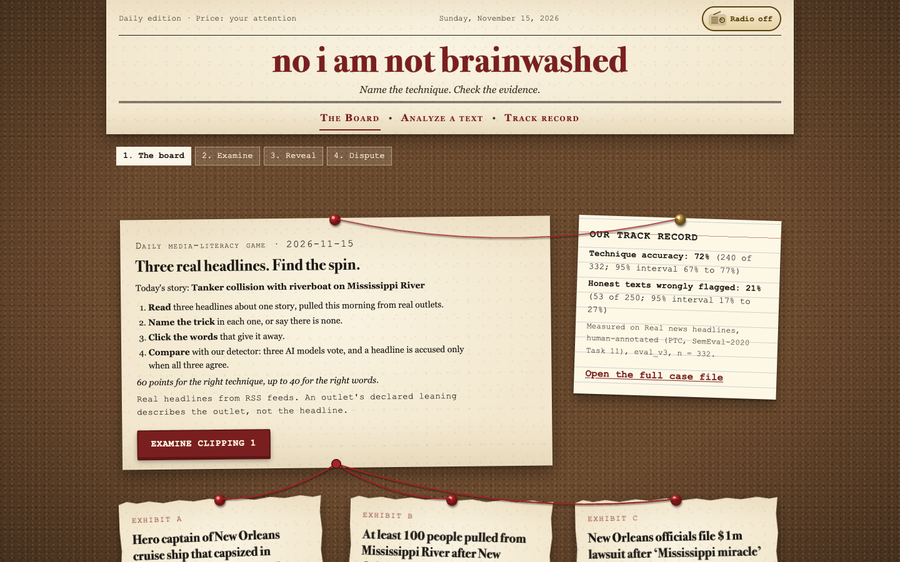
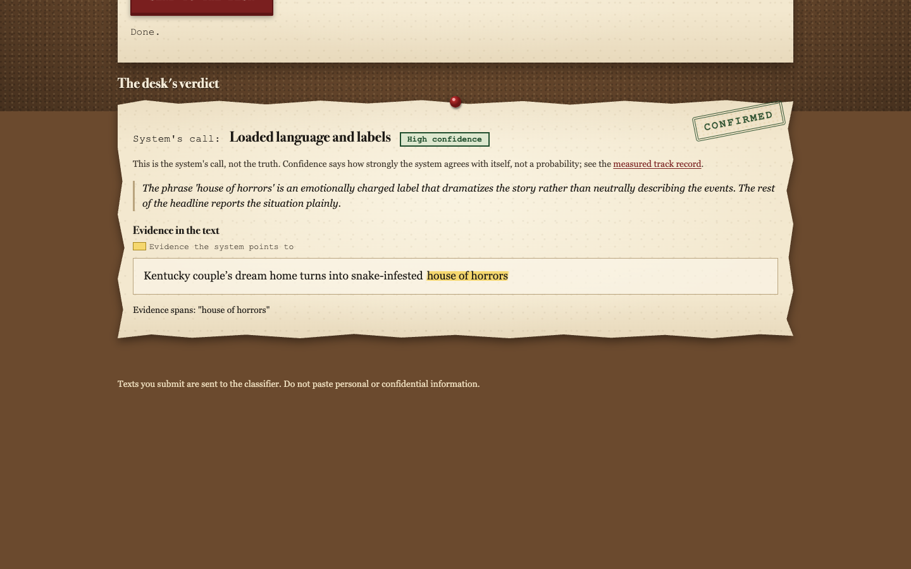
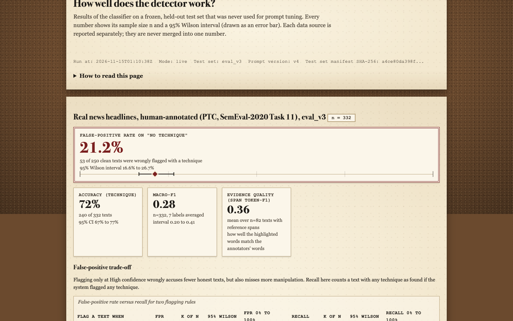

# no i am not brainwashed

**Name the technique. Check the evidence.**

A daily game and an open detector for manipulation techniques in news headlines, with its accuracy
and its mistakes measured in public. Built in one weekend at Junction 2026 for Hostinger's
"Decode the Noise" challenge, and running live on Hostinger.

**Live:** [iamnotbrainwashed.tech](https://iamnotbrainwashed.tech) ·
[Play today’s round](https://iamnotbrainwashed.tech) ·
[Analyze a text](https://iamnotbrainwashed.tech/analyze/) ·
[Track record](https://iamnotbrainwashed.tech/metrics/)



---

## Why

Manipulation in the news is rarely a lie. It is a word choice: *slams*, *experts warn*, *what else
are they hiding?* Most detectors answer with a black-box score like “87% propaganda”. You cannot
check it, you cannot learn from it, and when it is wrong it accuses an honest journalist.

We built the opposite: a tool that shows **which words** do the work, **why**, and **how often the
tool itself is wrong**.

## What it does

| | |
|---|---|
| **The Board** | A daily game. Every night the server pulls headlines from 35 outlets, groups them by story and picks three takes on one event. You name the technique in each, or say there is none, click the words that give it away, and compare with the detector. 60 points for the technique, up to 40 for the words. Disagree? Dispute the call. |
| **Analyze** | Paste any text or an https link. You get the technique, the exact words, a plain-language reason, and how many of the three models agreed. Or an honest “not accused”. |
| **Track record** | The detector's accuracy and false-accusation rate on frozen test sets, each number with its sample size and a 95% interval, plus the confusion matrix, per-model results and player disputes. |



## How the detector decides

1. The text goes to **three models from three vendors**, through the Hostinger AI Router:
   `claude-haiku-5.5`, `deepseek-v4.1-flash`, `gemini-3.7-flash`. Same prompt, independent answers.
2. Each model returns a technique, the exact words it relies on, and a one-line reason. Words that
   are not literally in the text are dropped; nothing is invented.
3. **A text is accused only when all three models name the same technique.** The evidence shown is
   the words at least two of them marked.
4. When only two of three see a technique, the text is **not accused**, and the page says so:
   *“2 of 3 models saw loaded language here, but a text is flagged only when 3 of 3 agree.”*

Why so strict: a false accusation costs more than a miss. Agreement is shown as a vote count
(“3 of 3”), never as a probability.

### Six techniques

| Technique | What it looks like |
|---|---|
| Loaded language and labels | emotionally charged words and labels: *house of horrors*, *slams* |
| Appeal to fear | pressure through fear: *we are all one accusation away from ruin* |
| Exaggeration or minimization | overstating or understating: *truly impossible* |
| Doubt | undermining without evidence: *what else are they hiding?* |
| Appeal to authority | an authority instead of evidence: *experts warn* |
| Changing the subject | deflection, whataboutism, straw man |

They map to the labels of the Propaganda Techniques Corpus (SemEval-2020 Task 11); techniques outside
these six are excluded from evaluation, never counted as “no technique”.

## How well it works

Measured on the frozen test set `eval_v3`, run once after every design choice was made on development
data. Each source is reported separately and never merged into one number.

| Test source | n | Accuracy | Honest texts wrongly accused |
|---|---|---|---|
| **Real news headlines, human-annotated** (PTC, SemEval-2020 Task 11) | 332 | **72.3%** (67.2–76.8) | **21.2%**, 53 of 250 (16.6–26.7) |
| SemEval-2021 Task 6 texts (human labels, meme captions) | 135 | 59.3% (50.8–67.2) | 2.4%, 1 of 41 (0.4–12.6) |
| Recent RSS headlines, labelled by one LLM (not human) | 70 | 72.9% (61.5–81.9) | 0%, 0 of 37 (0–9.4) |

95% Wilson intervals in brackets. The human-labelled news set comes first because it is the one we
neither chose nor labelled, and the one where we look worst.

**The trade-off we chose** (on the 332 human-labelled headlines):

| Rule | Honest headlines accused | Manipulative headlines caught |
|---|---|---|
| Accuse at 2 of 3 models | 34.0% (85 of 250) | 86.6% (71 of 82) |
| **Accuse only at 3 of 3 (default)** | **21.2% (53 of 250)** | **65.9% (54 of 82)** |

On that set the ensemble beats each model alone: accuracy 72.3% against 61.6–67.1%, and 21% of honest
headlines accused against 31–42%.



### How we keep the numbers honest

- **Frozen test sets.** Checksummed in a manifest before any tuning; the runner refuses to start if a
  file changed. A change means a new version.
- **Choices on dev data only.** The prompt examples, the model trio and the 3-of-3 rule were chosen on
  development data; the test set was then run once.
- **Every number has its n and an interval**, and per-technique numbers on tiny samples are flagged.
- **Mistakes stay in the log.** A run that turned out to have same-story near-duplicates between dev and
  test was discarded and recorded in [docs/STATUS.md](docs/STATUS.md), with the clean re-run.
- **Known limits are on the page**: PTC articles are from 2017–2019 and some loaded titles were left
  unmarked by its annotators (label noise we report, not fix); public datasets may be in the models'
  training data; rare techniques have very few examples and are mostly missed under the strict rule.
- **Disputes are opinions, not labels.** They are reviewed and can only ever reach the dev set.

## Running on Hostinger

```
 35 outlets (RSS) ──► nightly job, 00:00 Helsinki ──► Hostinger AI Router ──► Hostinger VPS
                      group headlines by story          3 models, one key       FastAPI + SQLite in Docker
                      (TF-IDF, cosine), pick rounds                             HTTPS via Traefik
```

- **Hostinger VPS** (KVM 2): Docker, with Hostinger's Traefik serving HTTPS (Let's Encrypt); no ports
  published to the host.
- **Hostinger AI Router**: all three models behind one OpenAI-compatible endpoint.
- **One-script deploy**: `deploy/deploy.sh` runs the tests, ships only committed files, builds the
  image on the VPS tagged by commit and waits for the health check; `deploy/rollback.sh` switches back.
- **Cost guards**: a verdict cache that survives redeploys, a per-IP rate limit and a daily cap on
  Analyze; https-only URLs with internal addresses refused.

## Run it locally

Needs Python 3.12 and [uv](https://docs.astral.sh/uv/).

```bash
uv sync
CORE_MODE=stub uv run uvicorn app.main:app --app-dir backend --port 8000
# open http://127.0.0.1:8000  (stub mode: fake verdicts, no key, no network)
# a fresh database has no rounds yet: add ?mock=1 for a demo round, or run the daily job in live mode
```

For real verdicts, copy `.env.example` to `.env`, add an AI Router key and set `CORE_MODE=live`.
The frontend also runs without a backend: serve `frontend/` as static files and add `?mock=1`
to any page (invented demo data, with a banner saying so).

```bash
uv run pytest -q                                              # tests: no network, no model calls
uv run python backend/eval/run.py --eval-version eval_v3      # evaluation (live mode needs a key)
```

## Repository

| Path | What is there |
|---|---|
| `backend/app/core/` | the one classifier: prompt, three-model calls, the 3-of-3 vote, cache |
| `backend/app/game/` | rounds, scoring (60 + 40 × token-F1), disputes |
| `backend/app/news/` | RSS feeds, story clustering, the nightly job |
| `backend/app/api/` | `/api/round`, `/api/answer`, `/api/dispute`, `/api/analyze`, `/api/metrics` |
| `backend/eval/` | evaluation runner, metrics, Wilson intervals, calibration, `results/` |
| `data/eval/` | frozen test sets (`eval_v3` is current), `data/dev/` development data |
| `frontend/` | the site: plain HTML, CSS and JavaScript, no build step |
| `deploy/` | deploy and rollback scripts for the VPS |
| `docs/` | [status and decision log](docs/STATUS.md), [architecture](docs/ARCHITECTURE.md), [demo script](docs/DEMO.md), [deployment](docs/DEPLOY.md), [data and taxonomy](docs/KNOWLEDGE_BASE.md), [team handbook](docs/HANDBOOK.md) |

## Data and credits

- **Propaganda Techniques Corpus**, SemEval-2020 Task 11 (Da San Martino et al.), CC BY 4.0,
  [Zenodo 3952415](https://zenodo.org/records/3952415).
- **SemEval-2021 Task 6** corpus (Dimitrov et al.),
  [github.com/di-dimitrov/SEMEVAL-2021-task6-corpus](https://github.com/di-dimitrov/SEMEVAL-2021-task6-corpus), free for research use.
- Daily headlines come from the outlets' public RSS feeds and link back to the source. An outlet's
  declared leaning describes the outlet, not the headline.

Code: [MIT](LICENSE).
